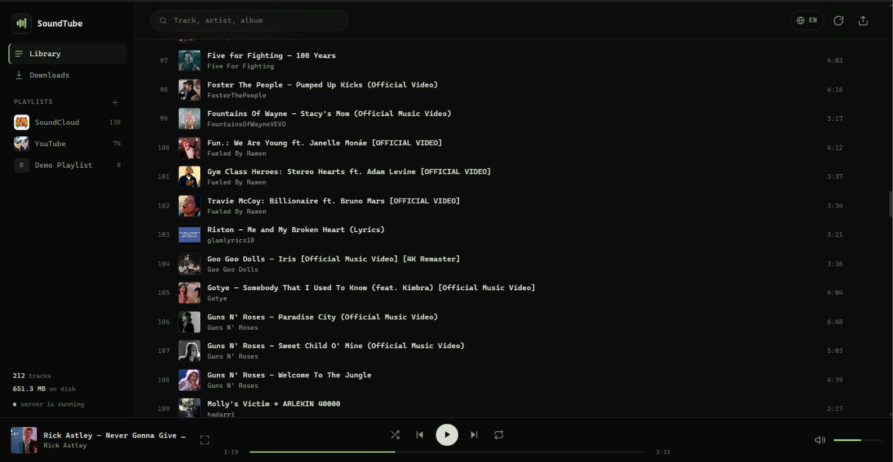
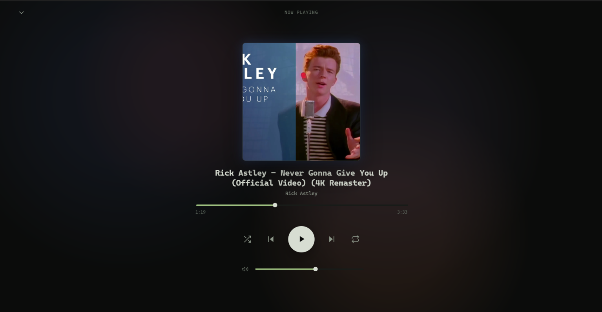
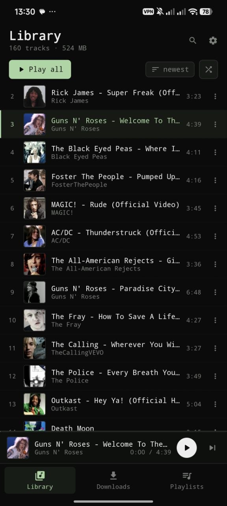
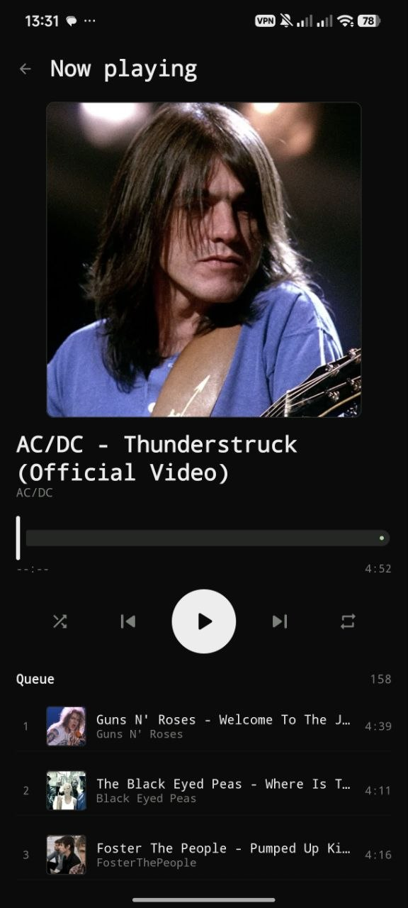

<div align="center">

<!-- Logo: swap for a dedicated asset in docs/ if you have one -->


# SoundTube

**Every track from YouTube and SoundCloud. One lightweight player. Desktop and mobile.**

No ads. No subscriptions. No limits.

[](#-download--install)
[](#-download--install)
[](#-download--install)

[](LICENSE)
[](https://github.com/Denisplokhikh/SoundTube/releases/latest)
[](https://github.com/Denisplokhikh/SoundTube/releases)
[](https://tauri.app)
[](https://kotlinlang.org)

<sub>[**Features**](#-features) • [**Screenshots**](#-screenshots) • [**Download**](#-download--install) • [**Tech Stack**](#-tech-stack) • [**Build from Source**](#-build-from-source)</sub>

</div>

<!-- 🎬 Hero preview: drop docs/screenshots/hero.gif and uncomment the block below -->

<!--
<p align="center">
  
</p>
-->

---

## Your music is scattered. Your player is bloated.

Your favorite album is on YouTube. The remix you actually want is on SoundCloud. The "all-in-one" player wants a monthly fee, the free one wants your attention, and the "lightweight" one turns out to be a 400 MB Electron app idling at 1.5 GB of RAM.

**SoundTube is the opposite.**

Paste a link — a single track, a 300-song playlist, a SoundCloud set — and it becomes **files on your disk**: tagged, sorted by artist and album, with cover art, playable with zero internet. The player itself is native, quiet on resources, and it never asks you to sign in, upgrade, or watch anything before the music starts.

> **One link in. A real library out.**

---

## ✨ Features

- 🎧 **Two giants, one window** — YouTube, YouTube Music and SoundCloud side by side. No tab juggling, no copy-pasting URLs between apps.
- 📦 **Batch downloads & full playlists** — Grab a single track or pull an entire playlist in one click. SoundCloud sets are parsed and queued just as easily as YouTube playlists.
- ⚡ **Ultra-light and fast** — Tauri 2 on desktop, native Kotlin on Android. Native webview and native UI mean no Chromium bundle and no RAM bonfire.
- 🖥️📱 **Cross-platform by design** — The same library, the same workflow, on Windows, Linux and Android — each one built as a first-class native experience, not a wrapped website.

<br>

- 🏷️ **Tagged on arrival** — ID3 / MP4 / Vorbis / FLAC tags and embedded artwork, files organized as `Artist/Album/Artist - Title`.
- 🎚️ **Formats on your terms** — Keep the original stream, or convert to MP3, M4A, Opus or FLAC.
- 🔁 **No duplicates** — Every track is tracked by its source URL. Already downloaded? It gets skipped, not downloaded twice.
- 🌈 **Living artwork** — A full-screen player whose waves borrow the palette from the cover and pulse with the beat.
- 🔄 **Library everywhere** — Export the whole library as one JSON file and import it on Android: same tracks and playlists, downloaded fresh on the phone. No PC needed afterwards.
- 🌐 **Two languages** — The interface speaks Russian and English; flip it with the globe button in the top-right corner.
- 🐳 **Docker, if that's your thing** — `docker compose up --build` and you have the same library on a home server.

---

## 📸 Screenshots

<!-- Screenshots live in docs/screenshots/: desktop.png, fullscreen.png, mobile.jpg, fullscreen_mobile.jpg -->

<table align="center">
  <tr>
    <td width="50%"></td>
    <td width="50%"></td>
  </tr>
  <tr>
    <td align="center"><sub><b>Desktop</b> — library, playlists and player</sub></td>
    <td align="center"><sub><b>Full-screen player</b> — palette borrowed from the cover</sub></td>
  </tr>
  <tr>
    <td align="center"></td>
    <td align="center"></td>
  </tr>
  <tr>
    <td align="center"><sub><b>Android</b> — library, downloads and playlists</sub></td>
    <td align="center"><sub><b>Now playing</b> — cover, controls and the queue</sub></td>
  </tr>
</table>

---

## 📥 Download & Install

Everything ships through **[GitHub Releases](https://github.com/Denisplokhikh/SoundTube/releases/latest)** — binaries are built by CI from the tagged source, not uploaded by hand.

### 🪟 Windows

| File | What it is |
| :--- | :--- |
| `SoundTube_<version>_x64-setup.exe` | NSIS installer — recommended |
| `SoundTube_<version>_x64_en-US.msi` | MSI package for managed / silent installs |

Download, run, done. Windows 10 and 11 already include WebView2.

### 🐧 Linux

| File | What it is |
| :--- | :--- |
| `SoundTube_<version>_amd64.AppImage` | Portable, no installation — `chmod +x` and run |
| `SoundTube_<version>_amd64.deb` | Debian / Ubuntu package, pulls `ffmpeg` automatically |

> On older distributions the AppImage may need `libfuse2`. `ffmpeg` is required at runtime and is bundled as a dependency in the `.deb`.

### 🤖 Android

| File | What it is |
| :--- | :--- |
| `SoundTube-<version>-android.apk` | Universal APK — Android 8.0+ |

Enable *Install unknown apps* for your browser or file manager, then open the APK. `arm64-v8a` and `x86_64` are both included.

<br>

<div align="center">

### [**⬇️ Download the latest release**](https://github.com/Denisplokhikh/SoundTube/releases/latest)

</div>

---

## 🛠 Tech Stack

Two codebases, one product. No shared runtime, no compromise.

<table>
<tr>
<td width="50%" valign="top">

### 🖥️ Desktop

**Shell**
- **Rust + Tauri 2** — native window, tray icon, single-digit MB binary
- **Python 3.11 / FastAPI** backend compiled to one binary with **PyInstaller**, spawned as a Tauri sidecar on `127.0.0.1`

**Engine**
- **yt-dlp** — link resolution and stream extraction
- **ffmpeg** — remuxing and format conversion
- **mutagen** — tags and embedded artwork
- **SQLite + SQLAlchemy** — job queue that survives restarts

**UI**
- Dependency-free **HTML / CSS / JS** — no bundler, no framework, instant load

</td>
<td width="50%" valign="top">

### 📱 Android

**UI**
- **Kotlin + Jetpack Compose** — Material 3, OLED-friendly dark theme
- **Navigation Compose**, **Coil** for artwork

**Architecture**
- **Hilt** — dependency injection
- **Room** — local library, schema migrations committed
- **WorkManager** — unique work queues per track/playlist, retries with backoff
- **Media3 / ExoPlayer + MediaSessionService** — background playback, lock-screen controls
- **Ktor + kotlinx.serialization** — LAN sync and JSON import/export

**Engine**
- **youtubedl-android** — yt-dlp, ffmpeg and aria2c as native libraries

</td>
</tr>
</table>

```text
soundtube/
├── app/          FastAPI core: queue, downloader, naming, tagging, platform parsers
├── web/          the entire desktop UI — plain HTML/CSS/JS
├── src-tauri/    Rust shell, sidecar wiring, bundle config
├── android/      native Kotlin app (Compose, Room, Media3, Hilt)
├── scripts/      build, release and dev helpers
└── tests/        pytest suite for the download pipeline
```

---

## 🚀 Build from Source

### Prerequisites

| Tool | Version | Needed for |
| :--- | :--- | :--- |
| [Python](https://python.org) + [uv](https://docs.astral.sh/uv/) | 3.11+ | Backend and sidecar |
| [Node.js](https://nodejs.org) | 20+ | Tauri CLI |
| [Rust](https://rustup.rs) | 1.77.2+ | Desktop shell |
| [ffmpeg](https://ffmpeg.org) | recent, on `PATH` | Download and conversion |
| JDK | 17 | Android |
| Android SDK | API 35 | Android |

```bash
git clone https://github.com/Denisplokhikh/SoundTube.git
cd SoundTube
```

### 🖥️ Desktop (Windows)

```powershell
uv sync --extra dev
npm install

# build the Python sidecar and launch the app
powershell -ExecutionPolicy Bypass -File scripts\desktop.ps1
```

Build an installer:

```powershell
powershell -ExecutionPolicy Bypass -File scripts\build-desktop.ps1
# → src-tauri\target\release\bundle\
```

Just the backend, with hot reload:

```powershell
uv run uvicorn app.main:app --reload --port 8765
# → http://127.0.0.1:8765
```

### 🐧 Desktop (Linux)

```bash
sudo bash scripts/linux/deps.sh   # system packages, Rust, Node, uv
bash scripts/build-linux.sh       # builds in ~/build/soundtube for speed
# → dist/linux/*.deb and *.AppImage
```

Add `--in-place` to build inside the repository instead of a sync copy.

### 🤖 Android

```bash
cd android
./gradlew assembleDebug
# → app/build/outputs/apk/debug/app-debug.apk

./gradlew assembleRelease   # signed via ANDROID_KEYSTORE_* env vars; debug key otherwise
```

The app targets API 35, supports Android 8.0+ and builds only for `arm64-v8a` and `x86_64` — the ABIs shipped by `youtubedl-android`.

### 🧪 Tests

```bash
uv run pytest
```

---

## 🗺 Roadmap

- [x] Desktop application on Tauri 2
- [x] Native Android app with offline playback
- [x] Library export from the desktop app to Android (JSON)
- [ ] Spotify playlist import by metadata + YouTube matching
- [ ] Search by `Artist - Title`
- [ ] M3U export and Navidrome / Jellyfin integration
- [ ] In-app settings screen

Got an idea or found a bug? [Open an issue](https://github.com/Denisplokhikh/SoundTube/issues) — pull requests are welcome.

---

## ⚠️ Disclaimer

SoundTube is an **educational, personal-use** project. It does not host, index, or distribute any copyrighted content — it only downloads media that *you* point it at, into *your* local library.

Downloading content may violate the terms of service of the source platforms and the copyright laws of your country. **You are responsible for how you use this tool.** The software is provided "as is", without warranty of any kind. If you are a rights holder and believe your work is being misused, open an issue and it will be addressed.

---

<div align="center">

### Enjoying SoundTube?

**It takes one click — and it helps the project more than you think.**

[](https://github.com/Denisplokhikh/SoundTube/stargazers)

[](https://star-history.com/#Denisplokhikh/SoundTube&Date)

<sub>Built with Rust, Python and Kotlin — because your music player shouldn't need a data center.</sub>

</div>
